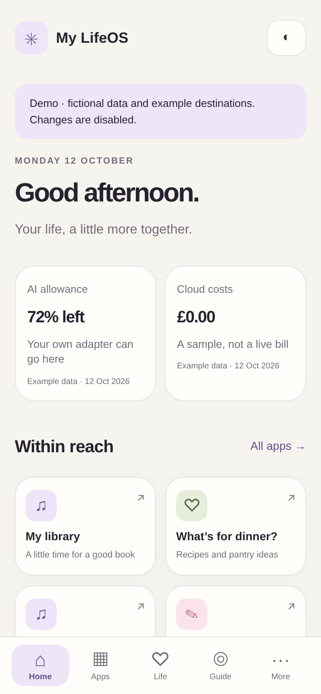

# Morpheos LifeOS

A small home for your digital life. Designed for Safari on iPhone, comfortable on a desktop, and self-hosted on your own server.

Your favourite apps, useful numbers, work in progress and weekly journal belong together. LifeOS gives them a quiet, understandable home. It grew from a real personal dashboard; this repository is a clean starter with fresh history and example data.



## Try it

Install [Node.js 24 LTS](https://nodejs.org/en/download), then:

```sh
git clone https://github.com/tylerbuilds/morpheos-lifeos.git
cd morpheos-lifeos
node server.mjs
```

Open **http://127.0.0.1:3000**. Choose a name, then add your links in **Apps → Organise**. No install step, database, API key or AI account is required to run the app.

For a read-only tour with fictional numbers and example destinations:

```sh
LIFEOS_DEMO=1 node server.mjs
```

## What you get

- Home with favourites and optional, source-labelled information cards.
- Searchable apps grouped into Life, Media, Games, Work & websites, Publishing, Projects in progress and Other.
- Add, rename, reorder, move, favourite and hide links without duplicate destinations.
- Changes saved on the server, shared across your devices, with conflict checks and recovery copies.
- A newest-first journal that reads dated Markdown files, including an existing Obsidian folder.
- Searchable setup and agent guidance with suggested chat categories.
- Light, dark and system themes, large touch controls, safe-area spacing and a Home Screen manifest.
- An optional password with 24-hour sessions. No trackers, analytics or external fonts.

This first release is a single-user starter. It does not include provider-specific billing integrations, a pantry inventory, a wardrobe database, an AI gateway or an automatic diary generator. You can link to those services and feed their summaries through the documented adapter format.

## Use it from your phone

Follow [the self-hosting guide](docs/self-hosting.md) to put LifeOS behind HTTPS with a password. In Safari, tap **Share → Add to Home Screen**.

External links open normally: use Safari Back, the browser sheet's Done button where available, or the app switcher after a native-app handoff. LifeOS does not frame third-party apps or inject navigation into them. Physical iPhone behaviour varies with iOS and the destination; browser tests are not a substitute for trying your own links.

## Your data

`data/dashboard.json` holds your links and settings. Every edit retains a previous version in `data/backups/`. Export/import is also available under More. An exclusive writer lock prevents two servers from editing the same directory. Do not run multiple replicas against one data folder.

Add journal files such as `data/journal/2026-01-11 - A useful week.md`, or set `LIFEOS_JOURNAL_DIR` to an existing directory. Notes are read-only; Markdown is shown as safe plain text. Up to 104 dated entries are displayed, newest first. Refresh to read new files. No recurring job is installed.

See [data adapters](docs/adapters.md), [backup and upgrades](docs/self-hosting.md#backup-and-upgrades), and [security](SECURITY.md). Runtime files and `.env` are excluded from Git and Docker builds. Exports may contain private addresses; keep them private.

## Development

```sh
npm ci --include=dev
npm run check
npm test
npx playwright install --with-deps chromium webkit
npm run test:browser
```

Runtime: Node built-ins and browser APIs only. Playwright is a development dependency. The automated suite checks authentication, cross-origin rejection, duplicate links, concurrent edits, backups, stale data, journal boundaries and phone layouts in Chromium and WebKit.

[Contributing](CONTRIBUTING.md) · [Architecture and provenance](docs/architecture.md) · [MIT licence](LICENSE)
